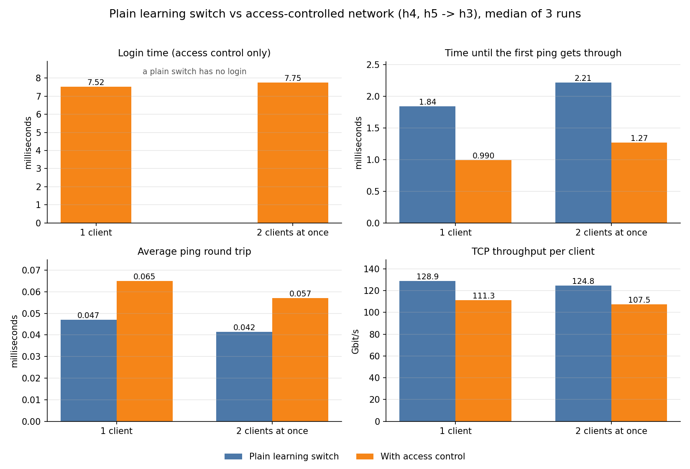

# Network access control with a TCP login server and an SDN controller

A host on this network cannot reach a protected service until it logs in. A small TCP server checks the
password. When it is correct, an SDN controller installs forwarding rules on the switch for that host,
and removes them again when the user logs out, goes quiet, or has been connected too long. Everything
runs in Mininet.

## 1. The problem

Ordinary switches forward traffic for anyone who is plugged in. We want the opposite: the network
denies everything by default and opens a path only for a user who has proved who they are, only for as
long as they are using it. That needs two parts that talk to each other:

* a **login service** (plain TCP sockets) that knows the users, and
* a **controller** that turns "this user logged in" into switch rules, and "this user left" into their removal.

## 2. Architecture

```
                 +--------------------------------+
                 |  Ryu controller (host OS)      |
                 |  sdn_controller.py             |
                 |   - OpenFlow 1.3 application   |
                 |   - REST API  10.0.0.254:8080  |
                 +--------+------------------+----+
                  OpenFlow 1.3            LOCAL port of s1
                  (tcp 6653)              (address 10.0.0.254)
                          |                  |
                 +--------+------------------+----+
                 |        Open vSwitch  s1        |   default rule: drop everything
                 +--+-------+-------+-------+--+--+
                    |       |       |       |  |
                   h1      h2      h3      h4  h5
                  spare   auth   target  client client
                         server  10.0.0.3
                        10.0.0.2
                        port 9999
```

All five hosts are on 10.0.0.0/24 with fixed addresses (`10.0.0.N`) and fixed MACs (`00:00:00:00:00:0N`);
`hN` sits on switch port `N`.

## 3. Components

| File | What it does |
|---|---|
| `topology.py` | Builds the Mininet network (one Open vSwitch `s1`, hosts h1 to h5), connects it to the controller, and gives the switch itself the address `10.0.0.254` so the controller's REST API is reachable on the data network. `create_net()` is also used by the tests and the benchmark. |
| `sdn_controller.py` | The Ryu application. Installs the default rules, and exposes a small REST API (`/auth/grant`, `/auth/revoke`, `/auth/block`) that only h2 may call. Turns each call into OpenFlow rules and logs every rule it installs or removes. |
| `auth_server.py` | The TCP login server on h2, port 9999 (one thread per client). Checks `users.json`, keeps the session table, counts wrong passwords, and calls the controller's REST API. |
| `client.py` | The user's program: asks for a username and password, logs in, stays connected sending heartbeats, and logs out on `logout` or Ctrl-C. |
| `users.json` | Demo accounts: `alice` / `password123` and `bob` / `securepass`. |
| `start.sh` | Cleans up, creates the API token if needed, starts Ryu, then starts Mininet. |
| `tests/` | `run_tests.py` (the six main checks) and three longer Mininet tests; `run_in_mininet.sh` runs any of them. |
| `benchmark.py`, `run_benchmark.sh`, `plot_results.py` | The performance comparison and its chart. |

### The switch's rules, by priority

| Priority | Rule | Purpose |
|---|---|---|
| 200 | drop all IP traffic from one host (hard timeout 60 s) | brute-force block |
| 100 | allow IP traffic between a logged-in client and the target, both directions (hard timeout 150 s) | the access a login earns |
| 30 | h2 (right port, MAC and IP) may reach the controller's API on TCP 8080, and only replies go back to h2 | the one path to the API |
| 25 | drop all other IP traffic to 10.0.0.254 | nobody else reaches the API |
| 10 | ARP, and all IP traffic to and from h2 | clients must be able to reach the login server |
| 0 | drop everything | default deny |

### Message flow

```
 client (h4)                    auth server (h2)                       controller              switch s1
     |                                |                                    |                       |
     |-- 1. login (user, password) -->|                                    |                       |
     |                                |-- check users.json                 |                       |
     |                                |-- 2. POST /auth/grant + token ---->|-- 3. flow-mod ------->|  2 rules, priority 100
     |<-- 4. SUCCESS + heartbeat time-|<-- 200 OK -------------------------|                       |
     |                                |                                    |                       |
     |-- 5. HEARTBEAT every 5 s ----->|  (OK)                              |                       |
     |   ... client now reaches h3 ...                                                             |
     |-- 6. LOGOUT ------------------>|-- 7. POST /auth/revoke + token --->|-- 8. delete rules --->|
     |<-- BYE ------------------------|                                    |                       |
```

* **Session limits.** No heartbeat for 15 s ends the session (idle timeout); a session also ends 120 s
  after login however many heartbeats arrive (absolute limit). A reaper thread in the auth server
  checks every second. The switch rules carry a 150 s hard timeout as a safety net in case the auth
  server dies.
* **Brute force.** The auth server counts wrong passwords per client IP. The third wrong password in a
  row gets the reply `BLOCKED`, and the server asks the controller (`/auth/block`) for a priority-200
  drop rule for that host with a 60 s hard timeout, so the switch lifts it by itself. A correct login
  resets the count. The auth server's own address can never be blocked.
* **Protecting the controller.** The REST API can be reached only by h2 (switch rules on port, MAC and
  IP), every call must carry the secret in the `api_token` file as an `X-Auth-Token` header (compared in
  constant time), and the controller also checks the caller's source address.

## 4. Install

You need Linux with:

* **Mininet** and **Open vSwitch** (`ovs-ofctl`), plus `iperf` (version 2) and `curl`;
* **Python 3** (system) with `requests` and, for the chart, `matplotlib`;
* **Python 3.10** for the Ryu virtual environment.

On Kali or Debian:

```bash
sudo apt install mininet openvswitch-switch iperf curl python3-requests python3-matplotlib
```

Ryu 4.34 is run from a virtual environment in `.venv` (Python 3.10, `setuptools==57.5.0`, which Ryu's
setup needs). It was built from a clone of the Ryu repository:

```bash
python3.10 -m venv .venv
.venv/bin/pip install "setuptools==57.5.0" wheel
git clone https://github.com/faucetsdn/ryu.git ~/ryu
.venv/bin/pip install ~/ryu
```

The login server, client, tests and benchmark run with the system `python3` (Mininet is installed for it),
usually through `sudo`. Only the controller runs in the virtual environment. Do not run anything except
Mininet and Open vSwitch commands as root.

## 5. Run it

```bash
./start.sh
```

This asks for your `sudo` password, creates `api_token` (a random secret, readable only by you) if it is
missing, starts the Ryu controller, and opens the Mininet prompt `mininet>`. When you leave the prompt
with `exit`, the controller is stopped.

The login server is started by hand, on h2, at the Mininet prompt:

```
mininet> h2 python3 auth_server.py > /tmp/auth_server.out 2>&1 &
```

Its decisions are written to `auth_audit.log`; the controller's rule log is `controller.log`.

## 6. Demo

At the Mininet prompt, after starting the login server:

```
# 1. Before login there is no access.
mininet> h4 ping -c 1 -W 1 h3                       # 100% packet loss

# 2. Log in as alice from h4 (stays connected, so it runs in the background).
mininet> h4 mkfifo /tmp/h4.in
mininet> h4 (printf 'alice\npassword123\n'; cat /tmp/h4.in) | python3 -u client.py > /tmp/h4.out 2>&1 &
mininet> h4 cat /tmp/h4.out                         # "[+] SUCCESS: ..."
mininet> h4 ping -c 2 h3                            # now it works
mininet> sh ovs-ofctl -O OpenFlow13 dump-flows s1 | grep priority=100     # the two access rules

# 3. Log out: the access disappears at once.
mininet> h4 echo logout > /tmp/h4.in
mininet> h4 ping -c 1 -W 1 h3                       # 100% packet loss again
mininet> sh ovs-ofctl -O OpenFlow13 dump-flows s1 | grep priority=100     # nothing

# 4. Brute force: three wrong passwords block the host.
mininet> h5 printf 'bob\nwrong\n' | python3 client.py      # DENIED
mininet> h5 printf 'bob\nwrong\n' | python3 client.py      # DENIED
mininet> h5 printf 'bob\nwrong\n' | python3 client.py      # BLOCKED
mininet> sh ovs-ofctl -O OpenFlow13 dump-flows s1 | grep priority=200     # the 60 s drop rule
mininet> h5 ping -c 1 -W 1 h2                       # cut off; the rule disappears after 60 s

# 5. The controller's API is not reachable from an ordinary host.
mininet> h4 curl -m 3 http://10.0.0.254:8080/auth/grant     # times out, no answer
```

Also worth showing: leave a logged-in client without heartbeats (for example `h4 kill -STOP <pid of
client.py>`); after about 15 seconds the access is gone. `tail controller.log` shows each rule being
installed and removed, with the reason.

## 7. Tests

```bash
tests/run_in_mininet.sh tests/run_tests.py
```

takes about two minutes, asks for your `sudo` password, and prints PASS or FAIL for six checks:

1. no login means no access
2. a valid login gives access
3. logout removes access
4. a wrong password is refused
5. three wrong passwords create the 60 s drop rule and cut the host off (and the switch lifts it by itself)
6. an ordinary host cannot reach the REST API

`tests/run_in_mininet.sh` cleans up Mininet, starts Ryu as your normal user, runs the test as root, and
stops Ryu again. The same script runs the longer tests from earlier work:
`test_api_isolation.py`, `test_session_idle.py` and `test_rule_lifecycle.py`.

## 8. Benchmark

```bash
./run_benchmark.sh
```

takes a few minutes and writes `results/benchmark.csv`, `results/benchmark.png` and
`results/benchmark_table.md`. It compares:

* **plain**: the same network with `ryu.app.simple_switch_13`, an ordinary learning switch, no login;
* **access control**: this project.

Each is measured with one client (h4) and with two clients (h4 and h5) working at the same moment, three
times over on a fresh network each time. Each client reports whether it can reach h3 before logging in,
the login time, the time until its first ping gets through (it sends a ping every 10 ms and reads the
time of the first reply), the average ping time over ten pings, and its iperf (TCP) throughput over five
seconds. In access-control mode the first-ping time is counted from the login's SUCCESS reply; in plain
mode, from the start (so it includes the switch learning the hosts).

## 9. Results

Measured on one machine inside Mininet (virtual links with no rate limit), so the numbers show the
*relative* cost of access control, not the limits of real hardware. Every scenario ran three times on a
fresh network; the table and chart show the median over all runs and clients. The raw numbers are in
`results/benchmark.csv`.



| Setup | Clients | Reached h3 before login | Login (ms) | First ping (ms) | Avg ping (ms) | Throughput per client (Mbit/s) |
|---|---|---|---|---|---|---|
| Plain learning switch | 1 | 3 of 3 | - | 1.8 | 0.047 | 128858 |
| Plain learning switch | 2 | 6 of 6 | - | 2.2 | 0.042 | 124763 |
| With access control | 1 | 0 of 3 | 7.5 | 1.0 | 0.065 | 111281 |
| With access control | 2 | 0 of 6 | 7.8 | 1.3 | 0.057 | 107494 |

What the numbers show:

* **Access control does what it should.** Before logging in, none of the 9 measurements with access
  control could reach h3; with the plain switch all 9 could.
* **Login is quick.** It takes about 8 ms (medians 7.5 ms and 7.8 ms; the individual runs ranged from
  4.8 ms to 11.3 ms). Two people logging in at the same moment were not noticeably slower.
* **After login the network is almost as fast.** Average ping is 0.057 to 0.065 ms with access control
  and 0.042 to 0.047 ms with the plain switch. That gap (about 0.02 ms) is smaller than the spread
  between runs (0.028 to 0.094 ms), so we do not read it as a real difference.
* **Throughput is about 14% lower with access control**: 111 against 129 Gbit/s per client with one
  client, and 107 against 125 Gbit/s with two. The gap is steady: every access-control run was below
  every plain run. We did not measure why. The likely cause is that the access rules send each packet to
  every port and to the controller's host (see future work). Two clients at once cost each of them only
  about 3% in both setups.
* **The first ping after login.** In 7 of the 9 measurements it got through in about 1 ms, which is
  faster than the plain switch (about 2 ms), probably because the plain switch has to learn the hosts
  first. In the other 2 (both clients of one two-client run) it took about 18 to 20 ms. That fits a small
  gap between the user being told SUCCESS and the switch having applied the rules: the controller answers
  the login server once it has sent the rules, not once the switch has confirmed them. This is visible in
  the CSV but not in the medians.

## 10. Future work

* **No flooding.** Access rules send packets to every port plus the controller's host (`ALL` + `LOCAL`)
  instead of only the right one. Output to the specific port would likely reduce the throughput cost seen
  above and would stop other hosts from seeing the traffic.
* **Match on MAC as well as IP**, so a host cannot use another host's address.
* **Encrypted login.** Passwords currently travel as plain text and sit in `users.json`. A
  challenge-response exchange with salted hashes would fix both.
* **Per-user policy.** Today every logged-in user reaches the same target. Roles and per-user
  allow and deny lists for specific services would give each user their own access.
* **A structured access log** (one JSON line per event, joined to the login log by a session id), and
  logging of denied packets.
* **An admin tool** to list sessions, revoke a user or block a host by hand.
* **More than one switch**, and TLS for the controller's REST API.
